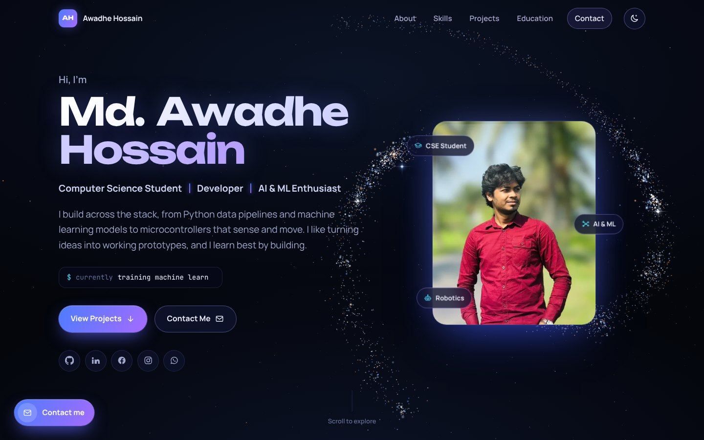
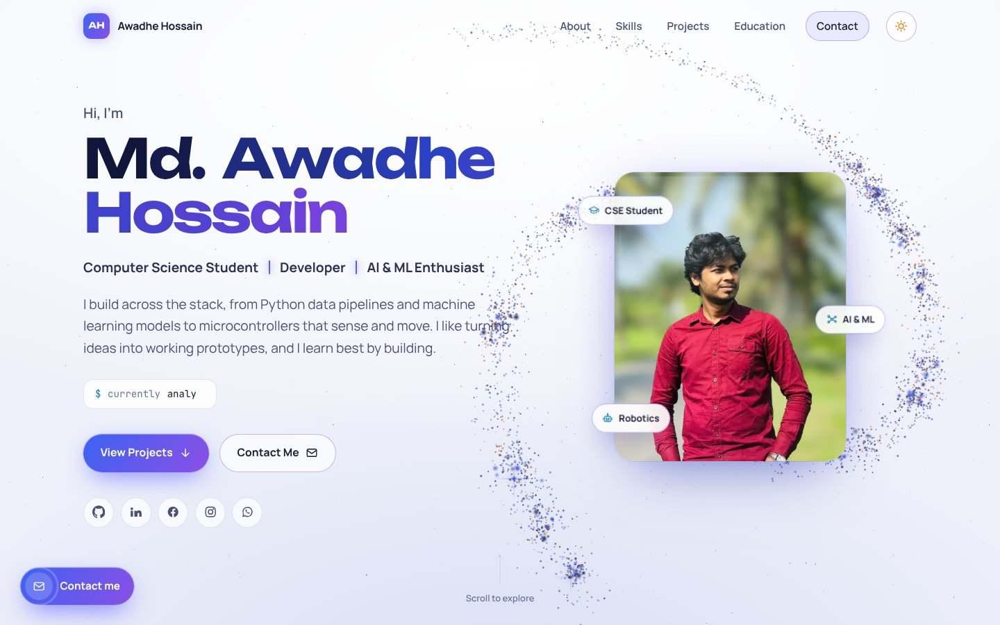
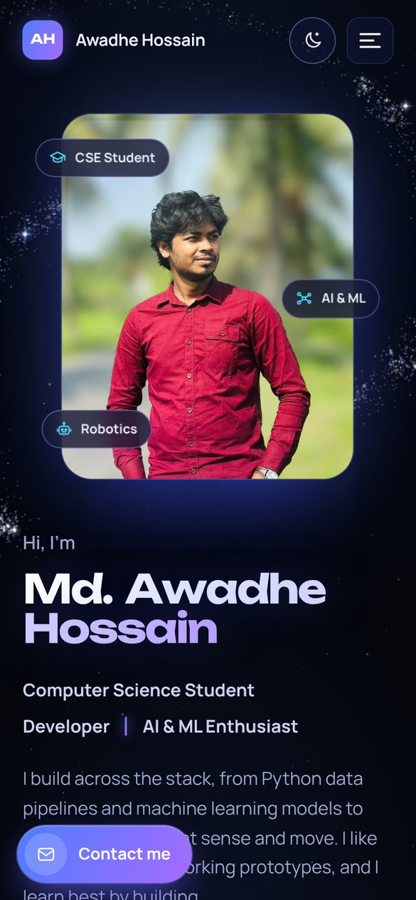
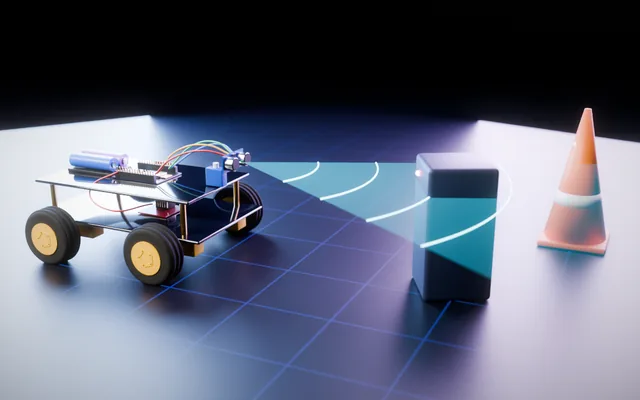
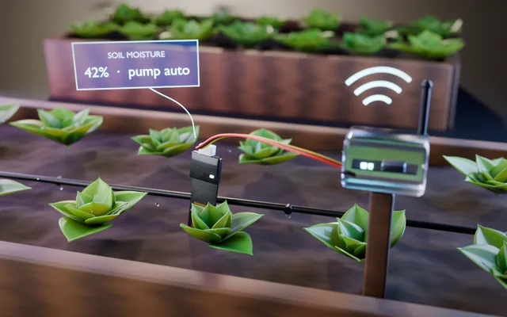
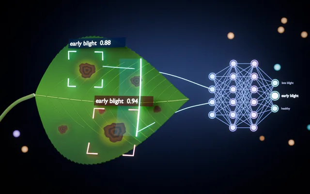

<div align="center">

# Md. Awadhe Hossain — Developer Portfolio

**Computer Science Student · Developer · AI & ML Enthusiast**

An interactive 3D portfolio with a particle galaxy, light and dark mode, and my work in robotics, IoT, machine learning and data analytics.

[](https://portfoliyo-three-omega.vercel.app)


<a href="https://portfoliyo-three-omega.vercel.app">
  
</a>

</div>

---

## Table of contents

- [About](#about)
- [Features](#features)
- [Light and dark mode](#light-and-dark-mode)
- [Projects on the site](#projects-on-the-site)
- [Built with](#built-with)
- [Project structure](#project-structure)
- [Run it locally](#run-it-locally)
- [Update the content](#update-the-content)
- [Contact form setup](#contact-form-setup)
- [Deployment](#deployment)
- [Performance and accessibility](#performance-and-accessibility)
- [Contact](#contact)
- [Credits](#credits)

---

## About

I'm **Md. Awadhe Hossain**, a B.Sc. in Computer Science & Engineering student at **United International University**, majoring in **AI & Data Science**. I build across the stack, from Python data pipelines and machine learning models to microcontrollers that sense and move.

This repository is the source code of my personal portfolio: **[portfoliyo-three-omega.vercel.app](https://portfoliyo-three-omega.vercel.app)**

## Features

- **Particle galaxy hero.** A two-armed spiral galaxy of glowing stars sits behind my portrait. It assembles from a swirl when the page opens, parts around the cursor, sends a shockwave on click, and unravels as you scroll past the hero.
- **The galaxy returns at the end.** As the *Let's build something* section scrolls in, the same journey plays backwards: the galaxy gathers from a faint swirl and settles behind the contact form.
- **Starfield background.** Thousands of tiny twinkling white, blue and amber stars fill the page with a gentle scroll parallax.
- **Portrait** with a blurred, portrait-mode background, 3D tilt on hover and floating badges.
- **Light and dark mode** with a circular reveal animation. Each visitor's choice is remembered.
- **Rendered project images** made for each project (robot, smart farm, leaf classifier, data dashboard).
- **Project filters** and a details dialog for every project.
- **Education timeline** that fills as you scroll, with results for each stage.
- **Contact in three ways:** an email form that delivers to my inbox, a phone number, and WhatsApp (including sending the form message straight to WhatsApp).
- **Floating "Contact me" button** in the bottom-left corner that jumps to the contact form.
- Glassmorphism UI, custom cursor, magnetic buttons, card tilt, scroll progress bar and a back-to-top button.
- **Responsive** from 320 px phones to wide desktops, keyboard accessible, and it respects *reduced motion*.

## Light and dark mode

| Dark | Light | Mobile |
|:---:|:---:|:---:|
|  |  |  |

Switch with the moon / sun button in the navigation bar. The site opens in dark mode by default.

## Projects on the site

<table>
  <tr>
    <td width="50%" valign="top">
      
      <h3>Autonomous Navigation Robot</h3>
      A self-driving rover that reads its distance sensors, decides on a path in real time and steers around obstacles.<br />
      <sub><b>C++ · Arduino · ESP32 · Ultrasonic sensors · Motor driver</b></sub>
    </td>
    <td width="50%" valign="top">
      
      <h3>Smart Agriculture System</h3>
      An ESP32 sensor node that tracks soil moisture, temperature and humidity, and waters the crops automatically.<br />
      <sub><b>ESP32 · C++ · IoT · Sensors · Wi-Fi</b></sub>
    </td>
  </tr>
  <tr>
    <td width="50%" valign="top">
      
      <h3>Crop Health Classifier</h3>
      A TensorFlow image classifier that spots signs of disease in photos of leaves.<br />
      <sub><b>Python · TensorFlow · NumPy · Matplotlib</b></sub>
    </td>
    <td width="50%" valign="top">
      
      <h3>Exploratory Data Analysis</h3>
      A Python workflow that cleans a real-world dataset, explores its trends and turns the findings into clear visual reports.<br />
      <sub><b>Python · Pandas · Matplotlib · Scikit-learn · Jupyter</b></sub>
    </td>
  </tr>
</table>

## Built with

| Area | Technology |
|---|---|
| Markup and styles | HTML5, CSS3 (custom properties, grid, backdrop blur, view transitions) |
| Logic | Vanilla JavaScript, ES modules, no framework, no build step |
| 3D | [Three.js](https://threejs.org) r187 with custom GLSL shaders |
| Fonts | Unbounded, Manrope, JetBrains Mono (self-hosted) |
| Contact form | [FormSubmit](https://formsubmit.co) |
| Hosting | [Vercel](https://vercel.com) |
| Project images | Rendered in Blender (Cycles); dashboard charts drawn with Matplotlib |

## Project structure

```
.
├── index.html                 Page skeleton, theme script and SVG icon sprite
├── css/
│   ├── base.css               Fonts, light/dark design tokens, reset
│   ├── layout.css             Background, navigation, theme toggle, footer
│   ├── components.css         Glass, buttons, chips, loader, cursor, dialog, form, floating buttons
│   ├── sections.css           Hero + portrait, About, Skills, Projects, Education, Contact
│   └── animations.css         Keyframes, hero intro, scroll reveals, reduced motion
├── js/
│   ├── main.js                Entry point: renders content, starts modules, lazy-loads 3D
│   ├── data/
│   │   └── portfolio.js       ← ALL editable content lives here
│   ├── modules/               App logic (no Three.js here)
│   │   ├── render.js          Builds markup from the data file
│   │   ├── theme.js           Light / dark mode
│   │   ├── contact.js         Form sending (email + WhatsApp), copy buttons
│   │   ├── contactFab.js      Floating "Contact me" button
│   │   ├── projects.js        Filters + project details dialog
│   │   ├── navigation.js      Nav, mobile menu, smooth scroll, active link
│   │   ├── hero.js            Letter split + typing effect
│   │   ├── timeline.js        Education timeline progress
│   │   ├── reveal.js          Scroll-triggered animations
│   │   ├── tilt.js            Card tilt, spotlight, magnetic buttons
│   │   ├── cursor.js          Custom cursor
│   │   ├── loader.js          Loading screen
│   │   └── backToTop.js       Back-to-top button
│   ├── three/                 Everything 3D, isolated from the app logic
│   │   ├── experience.js      Renderer, camera, scroll choreography, input, theme
│   │   ├── galaxy.js          Spiral galaxy
│   │   ├── starfield.js       Page-wide twinkling stars
│   │   ├── shaders.js         GLSL shaders
│   │   └── quality.js         Device-based quality tiers
│   ├── utils/dom.js           Shared helpers
│   └── vendor/                Three.js (minified, MIT licence)
├── assets/
│   ├── fonts/                 woff2 fonts
│   ├── icons/favicon.svg
│   └── images/
│       ├── profile/           Portrait (webp + jpg fallback)
│       └── projects/          Project images, 1200 px + 640 px (webp)
└── docs/                      Screenshots used in this README
```

## Run it locally

ES modules do not run from `file://`, so serve the folder with any static server:

```bash
# clone the repository (or download it as a ZIP from GitHub)
git clone <repository-url>
cd <repository-folder>

# then pick one
python -m http.server 8000        # open http://localhost:8000
npx serve .                       # Node.js
```

In VS Code you can also install the **Live Server** extension, right-click `index.html` and choose *Open with Live Server*. If you open `index.html` by double-clicking it, the page shows a short notice explaining this.

## Update the content

Every section is rendered from **`js/data/portfolio.js`**, so you never need to edit the HTML to change text or add a project.

| What | Where in `portfolio.js` |
|---|---|
| Name, roles, intro, typing phrases | `profile` |
| Email, phone, WhatsApp | `contact.email`, `contact.phone`, `contact.whatsapp` |
| Where form messages go | `contact.formEndpoint` |
| Social links | `socials` |
| About text and focus areas | `about` |
| Skills | `skillGroups` |
| Projects (text, images, GitHub and demo links) | `projects`, `projectFilters` |
| Education timeline | `education` (each entry has `facts` for Subject / Batch / GPA) |

- **Project links:** each project has `github` and `demo`. Leave `demo` empty to show a *View Details* button; add a URL to show *Live Demo*.
- **Project images:** `image` (1200 × 750) and `imageSmall` (640 px wide) in `assets/images/projects/`.
- **Portrait:** replace the files in `assets/images/profile/` with a 4:5 image using the same names.
- **Default theme:** change `t = 'dark'` in the inline script at the top of `index.html`.

## Contact form setup

*Send message* posts the form to [FormSubmit](https://formsubmit.co), which forwards it to my email. No account is needed, but the **first message activates the form**:

1. Open the live site and send a test message through the contact form.
2. Open the email from FormSubmit and click **Activate Form**.
3. Every message after that arrives in the inbox.

If sending fails (offline or blocked), the visitor's email app opens with the message filled in. *Send on WhatsApp* opens a chat with the message already typed. To use Formspree instead, paste your Formspree URL into `contact.formEndpoint`.

## Deployment

The site is static, with no build step, and is deployed on **Vercel** from this repository. Every push to `main` redeploys automatically.

**Vercel settings**

| Setting | Value |
|---|---|
| Framework Preset | Other |
| Root Directory | `./` |
| Build Command | *(empty)* |
| Output Directory | *(empty)* |

To publish an update:

```bash
git add .
git commit -m "Update portfolio"
git push
```

The site also works on GitHub Pages or any static host: upload the files with `index.html` at the root. All paths are relative, so it also works from a sub-folder.

## Performance and accessibility

- One WebGL renderer and one canvas for the whole page; Three.js is loaded lazily after the content renders.
- Quality tiers by device (pixel ratio, star and galaxy particle counts), plus automatic downgrading if the frame rate drops. Add `?hq` to the URL to switch the downgrade off while testing.
- Rendering pauses when the tab is hidden; additive shader glows instead of post-processing.
- Responsive images (`srcset`, WebP) and lazy-loaded project images.
- Semantic HTML, a skip link, visible focus styles, labelled controls, and full keyboard support.
- *Reduced motion* turns off the intro, the galaxy morph and the parallax.
- Without WebGL, a CSS night sky keeps the page looking right.

Works in current versions of Chrome, Edge, Firefox and Safari, on desktop and mobile.

## Contact

- **Email:** [awadhe12302@gmail.com](mailto:awadhe12302@gmail.com)
- **Phone / WhatsApp:** [+880 1821-947177](https://wa.me/8801821947177)
- **LinkedIn:** [in/paraffin67](https://www.linkedin.com/in/paraffin67/)
- **GitHub:** [@awadhehossain](https://github.com/awadhehossain)
- **Portfolio:** [portfoliyo-three-omega.vercel.app](https://portfoliyo-three-omega.vercel.app)

## Credits

- [Three.js](https://threejs.org) — MIT licence (`js/vendor/three.LICENSE.txt`)
- Fonts: Unbounded, Manrope and JetBrains Mono — SIL Open Font License
- Badges by [Shields.io](https://shields.io)

<div align="center">
<sub>Designed and built by Md. Awadhe Hossain</sub>
</div>
